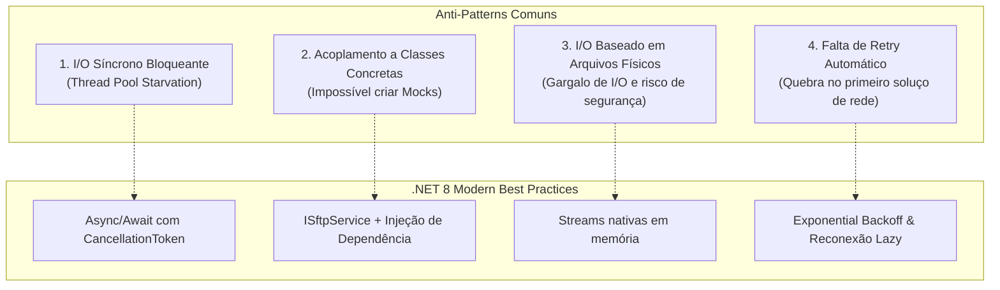

# Integrando SFTP em .NET de Forma Moderna: Resiliência, Injeção de Dependência e Zero Arquivos em Disco

Quem trabalha no desenvolvimento de software corporativo — especialmente em setores como financeiro, saúde, logística ou varejo — certamente já se deparou com este cenário: em plena era de microsserviços, mensageria e nuvem, a integração crítica com um parceiro externo, banco ou ERP legado ainda é feita através de... **SFTP**.

Arquivos de conciliação bancária (CNAB), faturamentos de ERPs (SAP, Totvs), prontuários e lotes de pedidos continuam trafegando diariamente via SFTP. 

No entanto, a grande maioria dos artigos e tutoriais de C# disponíveis na internet aborda o protocolo SFTP como fazíamos há 10 anos: código síncrono, classes concretas instanciadas sem injeção de dependência, ausência de testes unitários com mocks e falta de resiliência a quedas de rede.

Neste artigo, vamos analisar os erros mais comuns nessa integração e demonstrar como implementar transferências SFTP modernas e seguras em **.NET 8+** utilizando a biblioteca de código aberto **[SftpWrapper.Sdk](https://www.nuget.org/packages/SftpWrapper.Sdk/)**.

---

## Os 4 Grandes Anti-Patterns do SFTP em C#

Antes de ver o código moderno, vale identificar os problemas que costumam derrubar aplicações em produção:



### 1. I/O de Rede Síncrono (Thread Pool Starvation)
Em aplicações como ASP.NET Core ou Worker Services de alto rendimento, invocar operações síncronas (`client.UploadFile(...)` ou `client.Connect()`) bloqueia threads do ThreadPool enquanto espera pacotes trafegarem pela internet. Sob carga, todas as threads disponíveis ficam bloqueadas esperando sockets, e a API para de responder requisições HTTP triviais.

### 2. Classes Concretas sem Interfaces (Testabilidade Inexistente)
Muitos desenvolvedores instanciam `new SftpClient(...)` diretamente na regra de negócio. O resultado? Não é possível escrever um único teste unitário com mocks (usando Moq, NSubstitute ou FakeItEasy) para validar a regra sem ter um servidor SFTP real de pé.

### 3. Escrita Desnecessária no Disco Local
Criar arquivos temporários em disco (`Path.GetTempFileName()`) para baixar ou enviar dados é ineficiente em containers Docker/Kubernetes e arriscado para dados sensíveis (LGPD/GDPR). O ideal é transferir diretamente via `Stream` em memória.

### 4. Instabilidades de Rede e Quedas de Conexão
Conexões SSH/SFTP são suscetíveis a timeouts de firewall, resets de TCP e latência. Sem um mecanismo que trate falhas transitórias com reconexão automática e retry, jobs noturnos falham silenciosamente.

---

## A Solução: Arquitetura com SftpWrapper.Sdk

Para resolver essas dores com uma abordagem idiomática ao ecossistema .NET moderno, a biblioteca **SftpWrapper.Sdk** foi evoluída para oferecer:

* Contrato desacoplado e mockável via **`ISftpService`**.
* Suporte nativo a **`Stream`** e arquivos locais com **`async/await`** e **`CancellationToken`**.
* Extensão oficial para **Injeção de Dependência** (`AddSftpService`).
* **Resiliência nativa**: reconexão lazy e retries com exponential backoff.
* Autenticação via **Senha**, **Chave Privada (.pem)** ou chaves injetadas em memória direto do Azure Key Vault / AWS Secrets Manager.
* **Prevenção contra perda de dados**: por padrão, arquivos de origem nunca são apagados involuntariamente.

---

## Mão na Massa: Exemplo Prático em .NET 8

### 1. Instalação do Pacote

Adicione o pacote ao seu projeto:

```bash
dotnet add package SftpWrapper.Sdk --version 2.1.0
```

---

### 2. Configurando no `Program.cs`

Em uma Web API ou Worker Service, configure a injeção de dependência de forma limpa:

```csharp
using SftpWrapper.Sdk.Extensions;

var builder = WebApplication.CreateBuilder(args);

// Registro do SftpWrapper com opções fortemente tipadas
builder.Services.AddSftpService(options =>
{
    options.Host = builder.Configuration["Sftp:Host"] ?? "sftp.parceiro.com.br";
    options.Port = builder.Configuration.GetValue("Sftp:Port", 22);
    options.UserName = builder.Configuration["Sftp:UserName"] ?? "integracao_empresa";
    
    // Opção A: Autenticação por Senha
    options.Password = builder.Configuration["Sftp:Password"];

    // Opção B: Autenticação por Chave Privada (Recomendado para produção)
    // options.PrivateKeyContent = builder.Configuration["Sftp:PrivateKeyRaw"];
    // options.PrivateKeyPassphrase = builder.Configuration["Sftp:Passphrase"];

    // Configurações de Resiliência
    options.MaxRetryAttempts = 3;
    options.RetryDelay = TimeSpan.FromSeconds(2);
});

var app = builder.Build();
```

---

### 3. Consumindo no Serviço de Negócio com Streams (Zero Disco)

Imagine um cenário onde um relatório de conciliação bancária é gerado e precisa ser enviado diretamente para o SFTP sem salvar nada no disco local:

```csharp
using System.Text;
using SftpWrapper.Sdk.Abstractions;
using SftpWrapper.Sdk.Models;

public class ConciliacaoService
{
    private readonly ISftpService _sftpService;
    private readonly ILogger<ConciliacaoService> _logger;

    public ConciliacaoService(ISftpService sftpService, ILogger<ConciliacaoService> logger)
    {
        _sftpService = sftpService;
        _logger = logger;
    }

    public async Task ProcessarRemessaAsync(CancellationToken cancellationToken)
    {
        _logger.LogInformation("Gerando dados da remessa...");

        // 1. Gera o conteúdo em memória (ex: CSV ou arquivo posicional CNAB)
        var conteudoCsv = "Id;Cliente;Valor\n1;Empresa Alpha;15000.00\n2;Beta S/A;8250.50";
        var bytes = Encoding.UTF8.GetBytes(conteudoCsv);

        using var memoryStream = new MemoryStream(bytes);

        // 2. Upload direto da Stream para o SFTP (sem tocar no disco)
        var nomeArquivoRemoto = $"/remessas/remessa_{DateTime.UtcNow:yyyyMMdd_HHmmss}.csv";
        
        await _sftpService.UploadStreamAsync(
            memoryStream, 
            nomeArquivoRemoto, 
            overwrite: true, 
            cancellationToken: cancellationToken);

        _logger.LogInformation("Remessa {Arquivo} enviada com sucesso ao SFTP!", nomeArquivoRemoto);

        // 3. Listagem de arquivos de retorno disponíveis
        var arquivosRetorno = await _sftpService.ListFilesAsync(
            "/retornos", 
            extensionFilter: ".ret", 
            cancellationToken: cancellationToken);

        foreach (var item in arquivosRetorno)
        {
            _logger.LogInformation("Arquivo de retorno encontrado: {Nome} ({Tamanho} bytes)", item.Name, item.Length);

            // 4. Download direto para stream para processamento
            using var downloadStream = new MemoryStream();
            await _sftpService.DownloadStreamAsync(item.FullName, downloadStream, cancellationToken);
            
            // Processa o lote em memória...
        }
    }
}
```

---

### 4. Como Escrever Testes Unitários com Mocks

Graças à interface `ISftpService`, testar a regra de negócio acima agora é trivial e não requer conexão com a internet ou containers:

```csharp
using System.IO;
using System.Threading;
using System.Threading.Tasks;
using Moq;
using Microsoft.Extensions.Logging.Abstractions;
using SftpWrapper.Sdk.Abstractions;
using Xunit;

public class ConciliacaoServiceTests
{
    [Fact]
    public async Task ProcessarRemessa_DeveInvocarUploadStreamComSucesso()
    {
        // Arrange
        var mockSftp = new Mock<ISftpService>();
        var logger = NullLogger<ConciliacaoService>.Instance;

        mockSftp
            .Setup(s => s.UploadStreamAsync(
                It.IsAny<Stream>(), 
                It.Is<string>(path => path.StartsWith("/remessas/remessa_")), 
                true, 
                It.IsAny<CancellationToken>()))
            .Returns(Task.CompletedTask);

        var service = new ConciliacaoService(mockSftp.Object, logger);

        // Act
        await service.ProcessarRemessaAsync(CancellationToken.None);

        // Assert
        mockSftp.Verify(s => s.UploadStreamAsync(
            It.IsAny<Stream>(), 
            It.IsAny<string>(), 
            true, 
            It.IsAny<CancellationToken>()), Times.Once);
    }
}
```

---

## Um Toque a Mais de Segurança: Trusted Publishing no NuGet

Além da modernização de código, a biblioteca adota as diretrizes recomendadas pela Microsoft e OpenSSF para segurança de supply chain: a publicação no NuGet utiliza **Trusted Publishing com OpenID Connect (OIDC)** via GitHub Actions.

Isso significa que nenhum segredo estático (como tokens de API de longa duração) fica armazenado nos repositórios, reduzindo a zero a chance de vazamento de credenciais na esteira de CI/CD.

---

## Conclusão

Protocolos estabelecidos como o SFTP não precisam significar código legado. Ao adotar interfaces adequadas, operações assíncronas, streams em memória e resiliência com exponential backoff, você garante que sua aplicação continue estável, testável e pronta para rodar em qualquer ambiente de nuvem moderno.

* **Pacote no NuGet**: [SftpWrapper.Sdk 2.1.0](https://www.nuget.org/packages/SftpWrapper.Sdk/)
* **Código-Fonte no GitHub**: [rodrigodosanjosoliveira/sftpwrapper](https://github.com/rodrigodosanjosoliveira/sftpwrapper)
